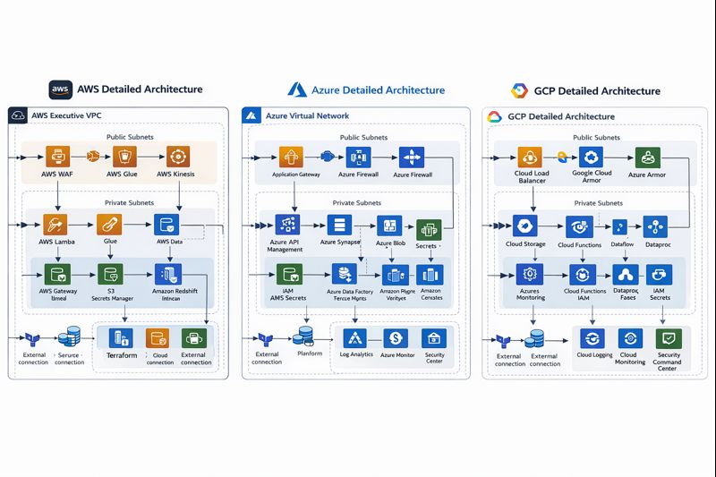

# Multi-Cloud Data & Analytics Platform – End-to-End Architecture (AWS + Azure + GCP)

This repository contains a **complete, job‑ready multi‑cloud architecture case study** for a fictional company, **NovaRetail**, that wants to modernize its analytics and machine‑learning stack across **AWS, Azure, and Google Cloud Platform (GCP)**.

The project is designed to be **portfolio‑ready**: everything here is fully written, complete, and ready to review. You can walk through it as if you designed and delivered this solution for a real client.

---

## Start here · Architecture case and evidence map



| Review question | Primary document |
| --- | --- |
| What problem are we solving? | [Requirements and constraints](case-study/01-business-context-and-requirements.md) |
| What is the overall architecture? | [Solution overview](case-study/02-solution-overview.md) · [Data flow and integration](case-study/06-data-flow-and-integration.md) |
| What changes across AWS / Azure / GCP? | [AWS](case-study/03-detailed-architecture-aws.md) · [Azure](case-study/04-detailed-architecture-azure.md) · [Google Cloud](case-study/05-detailed-architecture-gcp.md) |
| Is infrastructure specified as code? | [Terraform examples](infrastructure-as-code/terraform/README.md) |
| What security and reliability risks exist? | [Threat model](security/threat-model.md) · [Operations playbook](operations/incident-response-playbook.md) |
| How do we evaluate readiness and cost? | [Go-live checklist](tests-and-checklists/go-live-readiness-checklist.md) · [Cost discussion](case-study/09-cost-and-scaling-considerations.md) |
| What is actually verified? | **[Validation and limitations](VALIDATION_AND_LIMITATIONS.md)** |

**Reviewer walkthrough (10 minutes):** Read the requirements, inspect the architecture image, trace one data path through the platform, inspect its Terraform example, and test the operational assumptions against the threat model and readiness checklist.

### Project status: architectural design and simulation

NovaRetail is a fictional scenario. The repository contains **design documentation, Terraform source files, security/operational plans and readiness checklists**. A production deployment, validated multi-cloud Terraform apply, cost estimate from a live account, tested RTO/RPO, and regulatory compliance certification are **not claimed**. See the [evidence boundaries and optional non-deploying validation commands](VALIDATION_AND_LIMITATIONS.md).

**Design trade-offs to review:** cross-cloud egress and latency; data residency; state and credential management; observability; ownership of incidents; replay/idempotency; budget and quota constraints. A multi-cloud design is justified only where its benefits outweigh the operational cost.

[Portfolio website](https://jamiechristian22.github.io/) · [Cloud engineer portfolio](https://github.com/JamieChristian22/multi-cloud-engineer-portfolio) · [GitHub Sponsors](https://github.com/sponsors/JamieChristian22)

---

## 📌 Business Scenario

**NovaRetail** is a mid‑size global e‑commerce retailer:

- Customers in North America and Europe  
- Massive web and mobile traffic  
- Existing systems deployed in multiple clouds for historical reasons  

### Pain Points

1. Data is siloed across **AWS**, **Azure**, and **GCP**.
2. Reporting is slow and inconsistent between regions.
3. No unified **Customer 360** view for personalization.
4. Data governance and security practices differ in each cloud.
5. Leadership wants **real‑time dashboards**, **fraud detection**, and **personalized recommendations**.

### Goal

Design and document a **robust, secure, and scalable multi‑cloud data & analytics platform** that:

- Ingests operational data from all three clouds  
- Centralizes data into a unified analytics layer  
- Enables BI dashboards, ad‑hoc analytics, and ML models  
- Enforces strong security, governance, and observability  

---

## 🏗 High-Level Architecture

At a high level, the platform is built like this:

1. **AWS – Core Data Lake & Batch Processing**
   - S3 Data Lake (raw, curated, analytics zones)
   - AWS Glue ETL jobs
   - Amazon Redshift Serverless for warehouse queries
   - Amazon MSK / Kinesis for streaming events

2. **Azure – Analytics & Reporting Layer**
   - Azure Data Factory for cross‑cloud ingestion
   - Azure Data Lake Storage Gen2 as a regional analytics store
   - Azure Synapse Analytics for serving BI datasets
   - Power BI and Azure Monitor dashboards for business users

3. **GCP – Machine Learning & Advanced Analytics**
   - BigQuery as ML‑ready analytical store
   - Cloud Storage as landing zone for feature data
   - Vertex AI for model training, deployment, and batch predictions
   - Pub/Sub for streaming ingestion from AWS/Azure

4. **Cross‑Cloud Backbone**
   - Site‑to‑Site VPN / Private interconnect between clouds
   - Central Identity and Access strategy (federated IdP)
   - Centralized logging and alerting design that aggregates logs from all three clouds

The detailed documentation in this repo explains **exactly how data moves**, **which services are used**, and **how security, reliability, and operations are handled**.

---

## 📂 Repository Structure

```text
multi-cloud-architecture-case-study/
├─ README.md
├─ case-study/
│  ├─ 01-business-context-and-requirements.md
│  ├─ 02-solution-overview.md
│  ├─ 03-detailed-architecture-aws.md
│  ├─ 04-detailed-architecture-azure.md
│  ├─ 05-detailed-architecture-gcp.md
│  ├─ 06-data-flow-and-integration.md
│  ├─ 07-security-governance-and-compliance.md
│  ├─ 08-operations-monitoring-and-dr.md
│  └─ 09-cost-and-scaling-considerations.md
├─ infrastructure-as-code/
│  └─ terraform/
│     ├─ providers.tf
│     ├─ aws-network-and-storage.tf
│     ├─ aws-analytics-stack.tf
│     ├─ azure-network-and-storage.tf
│     ├─ azure-analytics-stack.tf
│     ├─ gcp-network-and-storage.tf
│     ├─ gcp-analytics-and-ml.tf
│     └─ variables.tf
├─ operations/
│  ├─ runbook-daily-operations.md
│  ├─ incident-response-playbook.md
│  └─ change-management-and-release-process.md
├─ security/
│  ├─ threat-model.md
│  ├─ data-classification-and-access-control.md
│  └─ audit-and-compliance-checklist.md
└─ tests-and-checklists/
   ├─ architecture-review-checklist.md
   ├─ go-live-readiness-checklist.md
   └─ dr-simulation-scenario.md
```

---

## ✅ How to Use This Project in Your Portfolio

You can present this project as a full **multi‑cloud solution** you designed:

1. Start with `case-study/01-business-context-and-requirements.md`  
2. Walk the interviewer through:
   - Business needs
   - Constraints and risks
   - End‑to‑end multi‑cloud architecture design
3. Show how AWS, Azure, and GCP each play a **clear, intentional role**.
4. Use the Terraform files in `infrastructure-as-code/terraform` to discuss how you would **codify** the architecture as Infrastructure‑as‑Code.
5. Use the `security/` and `operations/` folders to demonstrate your thinking around:
   - Security
   - Governance
   - Observability
   - Reliability and DR

Everything in this repo is **complete** — there are no placeholders and no “TBD” sections.

---

## 🧠 Skills Demonstrated

- Multi‑cloud architecture (AWS + Azure + GCP)
- Data lake and data warehouse design
- Streaming and batch ingestion patterns
- Cross‑cloud network design and identity strategy
- Security, compliance, and data governance
- Observability (logging, metrics, traces)
- Infrastructure as Code (Terraform – conceptual, vendor‑ready)
- Incident response, DR planning, and SRE practices

---

## 🗂 Where to Start

If you want a smooth narrative flow, read the documents in this order:

1. `case-study/01-business-context-and-requirements.md`  
2. `case-study/02-solution-overview.md`  
3. `case-study/06-data-flow-and-integration.md`  
4. `case-study/03-detailed-architecture-aws.md`  
5. `case-study/04-detailed-architecture-azure.md`  
6. `case-study/05-detailed-architecture-gcp.md`  
7. `case-study/07-security-governance-and-compliance.md`  
8. `case-study/08-operations-monitoring-and-dr.md`  
9. `case-study/09-cost-and-scaling-considerations.md`

## License and third-party materials

See [LICENSE](LICENSE) for the repository license. Third-party code, datasets, images, and other assets retain their respective terms.
